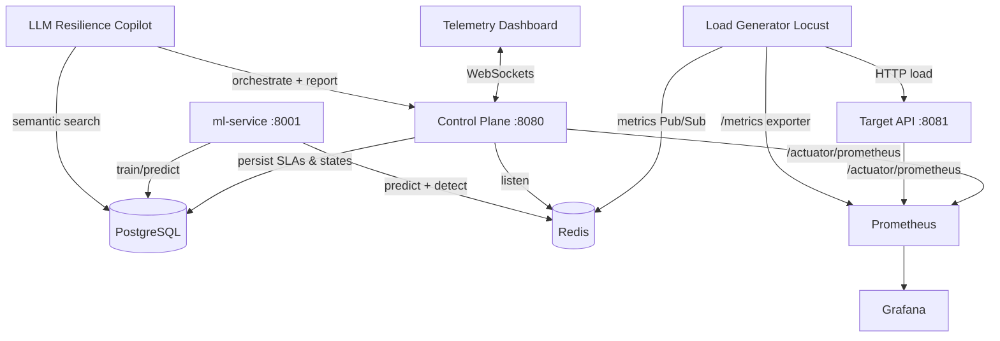

# 🚀 API Resilience Engine — Roadmap to "AI-Enabled Resilience Platform"

> A multi-week plan to evolve the core API Resilience Engine (load testing + chaos
> engineering + SLA validation) into a polished, job-market-impressive platform with a
> deliberate **AI / AIOps** differentiator — while hardening the SRE/DevOps fundamentals
> along the way.

## 🎯 Vision

Turn a *reactive* testing tool into a **proactive, self-healing, observability-rich**
platform. Instead of just "inject faults and watch," the engine should:

1. **Observe** deeply (real time-series telemetry, dashboards, alerts),
2. **Predict** failures **before** they happen (ML forecasting + real-time anomaly detection),
3. **Act** automatically (auto-stop / auto-rollback on SLA breach),
4. **Converse** in natural language (an LLM "Resilience Copilot").

This uniquely blends **SRE / DevOps**, **data & ML**, and **LLM application** skills —
a combination that stands out in an AI-steering job market.

## 🗺️ Weekly Roadmap (each week = standalone demoable milestone)

| Week | Theme | What you build | What you can show |
|------|-------|----------------|-------------------|
| 1 | **Telemetry Foundation** | Prometheus + Grafana, Spring Actuator/Micrometer exporters, Locust Prometheus exporter, long-term metrics, alert rules, auto-provisioned dashboards | Live Grafana dashboards under real load |
| 2 | **Real SLA Engine** | True p50/p95/p99/min/max percentile math from Redis aggregates (replace the mock), auto-stop + auto-rollback + webhook alert on breach, JUnit + Testcontainers | Math-backed, tested SLA engine |
| 3 | **Advanced Chaos + Game Days** | CPU/memory spikes, network latency, DB pool exhaustion, random 4xx; time-boxed "experiments" with blast radius + auto-recovery; persisted history | On-demand chaos experiment library |
| 4 | **Distributed Load + K8s + CI/CD** | Locust master/workers, Helm/minikube + autoscaling, GitHub Actions pipeline, merged dashboards, Makefile, repo hygiene | One-command deploy + green CI |
| 5 | **Predictive ML Core** | New `ml-service` (Python/FastAPI): time-series forecaster on historical metrics to predict SLA breach ahead of time; real-time anomaly detection; streams over Redis | "p99 trending to breach in ~2 min" proactive alert |
| 6 | **LLM Resilience Copilot** | Natural-language command → function-calling into the engine; LLM executive resilience reports; semantic search over history (pgvector) | Chat + auto-config + auto-reports |
| 7 | **Polish, Docs & Portfolio** | Full README + architecture diagrams, blog-style writeup, demo video + screenshots, security/config hardening | Complete sellable portfolio centerpiece |

## 🏗️ Architecture Target (end state)

## ✅ Ground Rules for Implementation

- **One week at a time.** Review plan → implement → verify → commit before moving on.
- Follow existing conventions: Spring Boot 4.0 / Java 17 LTS / Gradle 8.7+, Locust + Python,
  vanilla JS + Chart.js dashboard.
- Every milestone must be verifiable (builds/tests run where possible) and
  standalone-demoable.
- Weeks are independent enough that **any single week** is a portfolio win on its own.

## 📓 Milestone Log

- **Week 1 — Telemetry Foundation: 🟢 DONE**
  - [x] Add Spring Actuator + Micrometer Prometheus registry to Control Plane & Target API
  - [x] Add Prometheus exporter to Locust load generator
  - [x] Add `prometheus` + `grafana` services to Docker Compose
  - [x] Auto-provision Grafana datasource + dashboards
  - [x] Add alert rules (high error rate / high p99 / high failure ratio)
  - [x] Enable percentile histograms so latency panels (`histogram_quantile`) have data
  - [x] Verified live: all 3 Prometheus targets `up`, locust metrics scraped, chaos gauges
        reflected instantly, dashboard auto-loaded (see dev logs)

- **Week 2 — Real SLA Engine: 🟢 DONE**
  - [x] True p50/p95/p99/min/max **nearest-rank** percentile math over a 30s sliding
        window of raw latency samples streamed from Redis aggregates
        (`AggregateWindow`, `AggregatedMetrics`, `RedisAggregateListener`)
  - [x] Load generator publishes periodic `locust_aggregates` batches (ms timestamps +
        per-flush-interval error counts) that replace the previous mock values
  - [x] Auto-stop of the Locust swarm on SLA breach
  - [x] Auto-rollback of injected chaos on the Target API on breach
  - [x] Webhook alerts (Slack/Teams/PagerDuty/n8n) on breach via `WebhookAlertService`
        (`SLA_WEBHOOK_URL` env; disabled when empty)
  - [x] Live `/topic/alerts` breach banner + editable SLA policy + `/api/sla/status`
        percentile panel on the dashboard
  - [x] JUnit + Testcontainers tests (percentile math, sliding-window expiry,
        Redis aggregate ingestion end-to-end, SLA decision logic, full Spring
        context with Postgres + Redis) — all green

---
*Status legend: ⬜ not started · 🔄 in progress · ✅ done*
