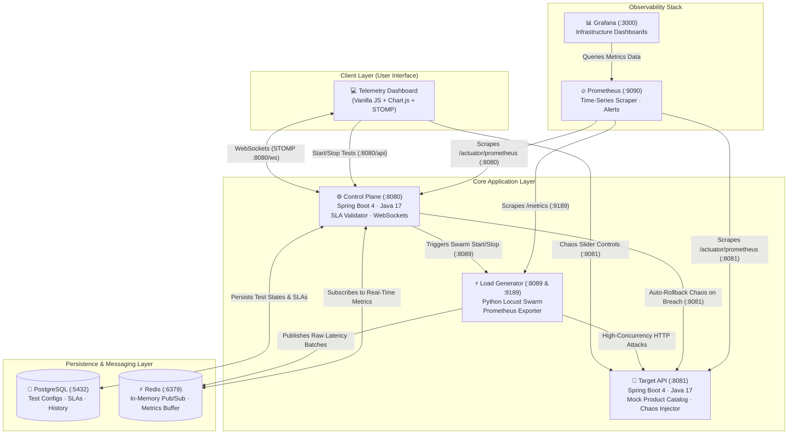
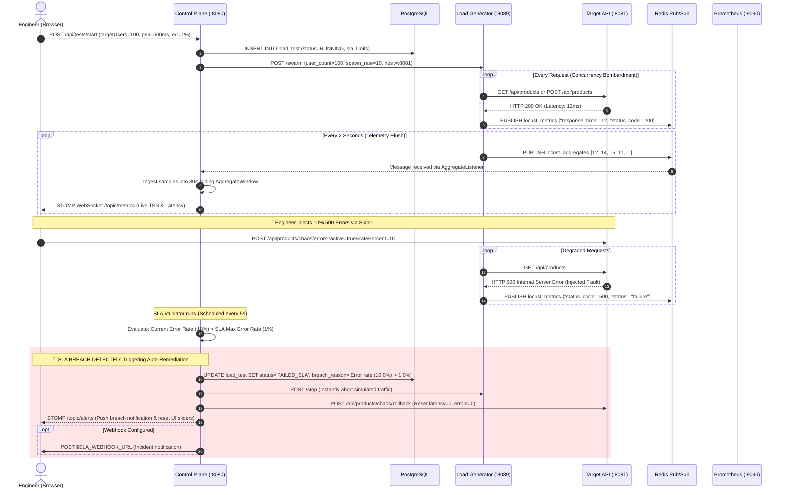

# 🛡️ API Resilience & Chaos Engineering Engine

> A distributed, cloud-native platform for high-concurrency API stress testing, real-time telemetry observation, chaos injection, mathematical SLA validation, and automated self-healing.

---

## 📖 Table of Contents
1. [What is This Project? (The Big Picture)](#-what-is-this-project-the-big-picture)
2. [Beginner's Guide to Core Concepts](#-beginners-guide-to-core-concepts)
3. [System Architecture & Container Ecosystem](#-system-architecture--container-ecosystem)
4. [Life of a Load Test: Step-by-Step Data Flows](#-life-of-a-load-test-step-by-step-data-flows)
5. [The SLA Engine & Auto-Remediation](#-the-sla-engine--auto-remediation)
6. [Observability Stack (Prometheus & Grafana)](#-observability-stack-prometheus--grafana)
7. [Getting Started (One-Command Setup)](#-getting-started-one-command-setup)
8. [Hands-On Demo Walkthrough](#-hands-on-demo-walkthrough)
9. [REST API & WebSocket Reference](#-rest-api--websocket-reference)
10. [Troubleshooting & FAQ](#-troubleshooting--faq)
11. [Project Directory Layout](#-project-directory-layout)

---

## 🌟 What is This Project? (The Big Picture)

### The Real-World Problem
Imagine an e-commerce website on Black Friday. Millions of shoppers hit the checkout button simultaneously. If the database slows down by just half a second, requests pile up like traffic behind an accident. Soon, application memory runs out, threads freeze, and the entire platform crashes—costing millions of dollars.

Traditionally, software teams discover these disasters **after** they hit production.

### The Solution: API Resilience Engine
The **API Resilience Engine** is a testing laboratory and automated safety net for web applications. It allows engineers to:
1. **Simulate Massive Traffic**: Bombard an API with hundreds or thousands of virtual users simultaneously.
2. **Inject Controlled Chaos**: Intentionally simulate real-world disasters—such as slow database queries, memory spikes, or server errors—while the traffic is running.
3. **Measure Performance with Strict Math**: Monitor real-time response times using rigorous mathematical percentiles (p50, p95, p99) instead of misleading averages.
4. **Trigger Automated Self-Healing (Auto-Remediation)**: If the system detects that user experience has breached a safety limit (an **SLA breach**), the engine immediately acts as an autopilot:
   - **Halts the simulated traffic swarm** before a total crash occurs.
   - **Rolls back all injected chaos** on the application.
   - **Dispatches instant incident alerts** to operations teams (via Webhooks to Slack, Microsoft Teams, PagerDuty, or n8n).

---

## 🧠 Beginner's Guide to Core Concepts

If you are new to backend systems, SRE (Site Reliability Engineering), or DevOps, here are the essential concepts explained simply:

### 1. What is an API?
An **Application Programming Interface (API)** is a digital doorway that allows different computer programs to talk to each other. For example, when a mobile app requests a list of products from a server, it sends an HTTP request (`GET /api/products`) to the API, and the API returns the product data.

### 2. What is Load Testing?
**Load testing** means testing how an API behaves when thousands of people use it at the exact same moment. We use a tool called **Locust** to spawn fleets of "virtual users" that send continuous streams of HTTP requests to measure how much throughput (requests per second) the system can endure.

### 3. What is Chaos Engineering?
**Chaos Engineering** is the practice of intentionally breaking things in a controlled environment to prove that the system can survive failure. Instead of hoping a database never slows down, we deliberately inject a 500ms delay into the database connection to see if our system degrades gracefully or crashes completely.

### 4. What is Latency, and Why Does "Average" Lie?
- **Latency** is the time (in milliseconds) it takes between a user sending a request and receiving a response.
- **Why averages are dangerous**: Imagine 99 users get a response in **10 ms**, but 1 user experiences a complete timeout taking **10,000 ms**.
  $$\text{Average Latency} = \frac{(99 \times 10) + 10,000}{100} = 109.9\text{ ms}$$
  The average looks acceptable (~110 ms), but 1% of your real customers had a catastrophic experience.
- **Percentiles to the rescue**:
  - **p50 (Median)**: 50% of requests were faster than this value.
  - **p95**: 95% of requests were faster than this value.
  - **p99**: 99% of requests were faster than this value. Only the slowest 1% took longer.
  Our platform computes **true nearest-rank percentiles** over live sliding time windows.

### 5. What is an SLA (Service Level Agreement)?
An **SLA** is a formal contract specifying the minimum acceptable level of service. For example:
> *"At least 99% of all requests must complete in under 500 ms (p99 $\le$ 500 ms), and total errors must not exceed 1%."*

If real-world performance crosses either boundary, it is classified as an **SLA Breach**.

---

## 🏗️ System Architecture & Container Ecosystem

The entire platform runs as **7 isolated Docker containers** orchestrated via Docker Compose, joined together by an internal virtual network (`resilience_net`).



### Detailed Breakdown of the 7 Services

| Service Name | Container Name | Technology | Port(s) | Role & Responsibility |
| :--- | :--- | :--- | :--- | :--- |
| **Control Plane** | `resilience_control` | Spring Boot 4, Java 17 | `8080` | Orchestrates test runs, listens to Redis telemetry streams, evaluates SLA rules every 5s, handles WebSockets, triggers webhook alerts, and manages the database. |
| **Target API** | `resilience_target` | Spring Boot 4, Java 17 | `8081` | The microservice being tested. Exposes product catalogue endpoints (`/api/products`) and contains built-in fault-injection filters (latency, 500 errors, 4xx errors, CPU spikes, DB pool exhaustion). |
| **Load Generator** | `resilience_locust` | Python 3.11, Locust | `8089`, `9189` | Simulates swarms of concurrent virtual shoppers bombarding the Target API. Ships metrics directly to Redis Pub/Sub and exposes Prometheus metrics on port `9189`. |
| **PostgreSQL** | `resilience_postgres` | PostgreSQL 15 | `5432` | Stores historical test metadata, user-configured SLA thresholds, start/completion timestamps, breach reasons, and chaos game day records. |
| **Redis** | `resilience_redis` | Redis 7 Alpine | `6379` | Ultra-fast in-memory message broker. Decouples the Load Generator from the Control Plane using Pub/Sub channels (`locust_metrics` and `locust_aggregates`). |
| **Prometheus** | `resilience_prometheus` | Prometheus v2.53 | `9090` | Cloud-native monitoring server. Automatically scrapes metrics from Spring Actuator and Locust every 5 seconds, and evaluates alert rules. |
| **Grafana** | `resilience_grafana` | Grafana 10.4 | `3000` | Pre-configured dashboard visualization platform. Auto-loads datasource and custom "Resilience Engine Overview" dashboards on startup. |

---

## 🔄 Life of a Load Test: Step-by-Step Data Flows

Here is what happens under the hood when a test is executed:



---

## 🛡️ The SLA Engine & Auto-Remediation

### Mathematical Foundation: Real Nearest-Rank Percentiles
Many basic monitoring tools calculate approximate percentiles or averages that hide micro-bursts and tail latency. 

The API Resilience Engine maintains a **thread-safe, sliding 30-second window** of raw latency samples (`AggregateWindow.java`):
1. **Ingestion**: Every 2 seconds, the Locust generator flushes an array of exact millisecond latency integers to Redis.
2. **Nearest-Rank Calculation**:
   - The samples are sorted: $v_1 \le v_2 \le \dots \le v_N$.
   - The rank $k$ for percentile $P$ (e.g., 99th percentile) is calculated using:
     $$k = \lceil \frac{P}{100} \times N \rceil$$
   - The percentile value is $v_k$.
3. **Sliding Expiration**: As time progresses, samples older than 30 seconds are evicted from memory, preventing historical data from distorting present reality.

### Auto-Remediation Pipeline
Every 5 seconds, `SlaValidatorService` inspects all tests currently marked as `RUNNING`:
1. It queries the live percentiles and current error rate from `AggregateWindow`.
2. It compares them against the thresholds chosen by the user before starting the test:
   - **p99 Latency Breach**: $\text{Current p99} > \text{SLA Target (ms)}$
   - **Error Rate Breach**: $\text{Current Error Rate} > \text{SLA Max Error Rate (\% intercepts)}$
3. If an SLA is breached:
   - **Stop Traffic**: Immediately sends an HTTP call to Locust to stop sending requests.
   - **Roll Back Chaos**: Sends an HTTP call to the Target API to immediately disable artificial delays and faults.
   - **Alert**: Pushes a live message to the browser dashboard and fires an external webhook notification if `SLA_WEBHOOK_URL` is set in the environment.

---

## 📈 Observability Stack (Prometheus & Grafana)

The engine ships with a fully automated, **Infrastructure-as-Code (IaC)** observability stack. You don't need to manually create dashboards or add data sources.

### 1. Prometheus (`http://localhost:9090`)
Prometheus operates on a pull-model, automatically scraping metrics every 5 seconds:
- **Target API & Control Plane**: Scraped via Spring Boot Actuator (`/actuator/prometheus`). Exports JVM heap, CPU utilization, thread pool saturation, HTTP request duration histograms, and chaos gauge levels.
- **Locust Load Generator**: Scraped via custom Python Prometheus exporter (`:9189/metrics`). Exports active users, total requests, failure ratios, and response time histograms.
- **Automated Alerts** (defined in `monitoring/prometheus/alerts.yml`):
  - `TargetHigh5xxRate`: Triggers if the Target API returns high 5xx errors for $> 30$ seconds.
  - `TargetHighP99Latency`: Triggers if p99 latency climbs over 1 second for $> 1$ minute.
  - `LoadTestHighFailureRate`: Triggers if Locust reports $> 5\%$ failure rates.

### 2. Grafana (`http://localhost:3000`)
- **Login**: Username: `admin` | Password: `admin`
- Pre-provisioned with the **"Resilience Engine Overview"** dashboard.
- Displays:
  - Throughput (RPS) timeline.
  - Error rate percentage.
  - Latency heatmaps ($p50$, $p95$, $p99$).
  - Target API JVM memory usage & CPU utilization.
  - Locust virtual user concurrency.

---

## 🚀 Getting Started (One-Command Setup)

### Prerequisites
- **Docker Desktop** installed and running on your system (Windows, macOS, or Linux).
- *No local installation of Java, Gradle, Python, PostgreSQL, or Redis is needed!* Everything is built and packaged inside containerized multi-stage Docker builds.

### Step 1: Start the Cluster
Open your terminal in the root of the project directory and run:

```bash
docker compose up --build
```

*(The first time you run this, Docker will download the base images and compile the Spring Boot applications. This takes 2 to 3 minutes).*

### Step 2: Verify All 7 Containers are Running
Run:
```bash
docker compose ps
```
You should see all 7 services in status `Up`:
```text
NAME                    STATUS          PORTS
resilience_control      Up              0.0.0.0:8080->8080/tcp
resilience_grafana      Up              0.0.0.0:3000->3000/tcp
resilience_locust       Up              0.0.0.0:8089->8089/tcp, 0.0.0.0:9189->9189/tcp
resilience_postgres     Up              0.0.0.0:5432->5432/tcp
resilience_prometheus   Up              0.0.0.0:9090->9090/tcp
resilience_redis        Up              0.0.0.0:6379->6379/tcp
resilience_target       Up              0.0.0.0:8081->8081/tcp
```

### Step 3: Open the Platform
You have two easy ways to open the Telemetry Dashboard:
1. **Via Web Browser (Recommended)**: Navigate to [http://localhost:8080](http://localhost:8080)
2. **Via Local File**: Double-click `dashboard/index.html` on your computer.

The status dot in the upper-right corner will turn **green** with the text:
`Connected to Control Plane`.

---

## 🎮 Hands-On Demo Walkthrough

Try these four scenarios to see the platform in action:

### Scenario 1: The Healthy Baseline Load Test
1. Open the dashboard at [http://localhost:8080](http://localhost:8080).
2. Under **SLA Policy**, leave the defaults: `Max p99 Latency: 500 ms` and `Max Error Rate: 1%`.
3. Click **Start Load Test**.
4. **Observe**:
   - The throughput climbs to $\sim 150\text{--}300\text{ req/s}$.
   - The average latency remains low ($\sim 5\text{--}15\text{ ms}$).
   - The line chart draws live response times.
   - The **Real-Time SLA Engine** panel displays $p50$, $p95$, and $p99$ percentiles.
5. Click **Stop Test** to finish the baseline run.

---

### Scenario 2: Database Latency Spike & Latency Breach
1. Click **Start Load Test**.
2. While the test is running, locate the **Inject DB Latency** slider.
3. Slide it to **600 ms**.
4. **Observe**:
   - The live latency chart spikes immediately above 600 ms.
   - The $p99$ percentile card updates to $> 600\text{ ms}$.
   - Within 5 seconds, the scheduled SLA validator flags the condition ($600\text{ ms} > 500\text{ ms}$).
   - **Auto-remediation triggers**:
     - The yellow/red **SLA Breach Detected** banner appears at the top.
     - The load test automatically stops (`btnStart` re-enables).
     - The latency slider automatically resets back to `0 ms`.

---

### Scenario 3: Error Rate Breach & Auto-Rollback
1. Click **Start Load Test**.
2. Under **Inject 500 Errors**, slide the slider to **15%**.
3. **Observe**:
   - The **Error Rate** card turns red and climbs to $\sim 15\%$.
   - The SLA validator detects that the error rate ($15\%$) exceeds the configured maximum threshold ($1\%$).
   - The test auto-terminates with reason: `error rate (15.00%) exceeded SLA limit (1.00%)`.
   - The error injection is immediately rolled back to `0%`.

---

### Scenario 4: Observing the Metrics in Grafana
1. Open [http://localhost:3000](http://localhost:3000) in your browser.
2. Log in with:
   - **Username**: `admin`
   - **Password**: `admin`
3. Click on **Dashboards** $\rightarrow$ **Resilience Engine Overview**.
4. Run a load test on the main dashboard, and observe Grafana visualizing:
   - Prometheus-scraped HTTP requests per second.
   - JVM heap memory usage.
   - Chaos fault indicators.

---

## 🔌 REST API & WebSocket Reference

You can also interact directly with the backend services via `curl` or Postman:

### 1. Control Plane (`http://localhost:8080`)
| Method | Endpoint | Description |
| :--- | :--- | :--- |
| `GET` | `/api/tests` | Returns JSON list of all historical load test runs. |
| `POST` | `/api/tests/start` | Starts a test run. Body: `{"name":"My Test","targetUsers":100,"spawnRate":10,"slaMaxP99Latency":500,"slaMaxErrorRate":1}` |
| `POST` | `/api/tests/{id}/stop` | Manually stops a running test. |
| `GET` | `/api/sla/status` | Returns the latest 30-second percentiles (`p50`, `p95`, `p99`, `min`, `max`, `error_rate`, `sample_count`). |
| `WS` | `/ws` | WebSocket / SockJS STOMP endpoint. Subscriptions: `/topic/metrics` and `/topic/alerts`. |

### 2. Target API (`http://localhost:8081`)
| Method | Endpoint | Description |
| :--- | :--- | :--- |
| `GET` | `/api/products` | Returns catalogue of mock products. |
| `POST` | `/api/products` | Creates a new product. Body: `{"name":"Item","price":29.99}` |
| `POST` | `/api/products/chaos/delay?ms=400` | Artificially delays all responses by `ms` milliseconds. |
| `POST` | `/api/products/chaos/errors?active=true&ratePercent=20` | Forces the API to fail with HTTP 500 on `ratePercent` percent of requests. |
| `POST` | `/api/products/chaos/rollback` | Resets all active chaos injections back to baseline (0 ms delay, 0% errors). |

### 3. Load Generator (`http://localhost:8089`)
| Method | Endpoint | Description |
| :--- | :--- | :--- |
| `GET` | `/` | Web interface for Locust. |
| `POST` | `/swarm` | Initiates locust user generation. |
| `POST` | `/stop` | Stops all simulated traffic. |
| `GET` | `:9189/metrics` | Prometheus metrics exporter port. |

---

## ❓ Troubleshooting & FAQ

### 1. Dashboard shows "Disconnected (Retrying...)"
- **Check if containers are running**: Run `docker compose ps` and make sure `resilience_control` is `Up`.
- **Browser Origin**: If you opened the file directly via `file:///`, make sure you have the latest code which supports native WebSocket fallback. Alternatively, open the dashboard via [http://localhost:8080](http://localhost:8080).
- **Check container logs**: Run `docker compose logs control-plane` to verify Spring Boot started successfully.

### 2. Port conflict: "port is already allocated"
If you already have a local PostgreSQL (`5432`) or Redis (`6379`) running on your machine:
- Temporarily stop your local services, or
- Modify the host port mappings in [`docker-compose.yml`](file:///c:/Users/durga/Desktop/Chinna/Project_1/docker-compose.yml) (e.g. change `"5432:5432"` to `"5433:5432"`).

### 3. How do I completely reset the database and start fresh?
If you want to clear all historical tests and reset PostgreSQL and Redis data volumes:
```bash
docker compose down -v
docker compose up --build
```
The `-v` flag removes the Docker volumes so fresh tables are created automatically on startup.

---

## 📁 Project Directory Layout

```text
Project_1/
├── control-plane/                 # Spring Boot 4 orchestrator service
│   ├── src/main/java/             # Java source code
│   │   └── com/example/control_plane/
│   │       ├── AggregateWindow.java      # 30-second sliding percentile engine
│   │       ├── LoadTestController.java   # REST API for test lifecycle
│   │       ├── SlaValidatorService.java  # Scheduled 5s SLA checking & auto-remediation
│   │       ├── WebhookAlertService.java  # External incident alerting integration
│   │       └── WebSocketConfig.java      # STOMP / SockJS WebSocket configuration
│   ├── src/main/resources/
│   │   ├── application.properties        # Postgres & Redis connection properties
│   │   └── static/                       # Bundled static dashboard assets
│   └── Dockerfile                        # Multi-stage JDK 17 build
│
├── target-api/                    # Spring Boot 4 mock microservice
│   ├── src/main/java/             # Java source code
│   │   └── com/example/target_api/
│   │       ├── MockController.java       # Product catalogue endpoints
│   │       └── ChaosService.java         # Fault injection engine (latency, 5xx, CPU, memory)
│   └── Dockerfile                        # Multi-stage JDK 17 build
│
├── load-generator/                # Locust load testing service
│   ├── locustfile.py              # Locust user traffic swarm & Redis publisher
│   ├── requirements.txt           # Python dependencies (locust, redis, prometheus_client)
│   └── Dockerfile                        # Python 3.11 container setup
│
├── dashboard/                     # Standalone frontend UI
│   ├── index.html                 # Glassmorphic dashboard layout
│   ├── style.css                  # Modern responsive styling & animations
│   └── app.js                     # Chart.js graphs, STOMP client, slider event listeners
│
├── monitoring/                    # Observability as Code
│   ├── prometheus/
│   │   ├── prometheus.yml         # Prometheus scrape configuration
│   │   └── alerts.yml             # SLA alert rules
│   └── grafana/
│       ├── provisioning/          # Datasource & dashboard auto-loaders
│       └── dashboards/            # "Resilience Engine Overview" JSON model
│
├── docker-compose.yml             # Orchestrates all 7 services on resilience_net
└── README.md                      # Comprehensive project documentation
```

---

## 📜 License & Credits
Built for cloud-native performance engineering, site reliability demonstration, and chaos experiment automation. Free for educational and open development use.
